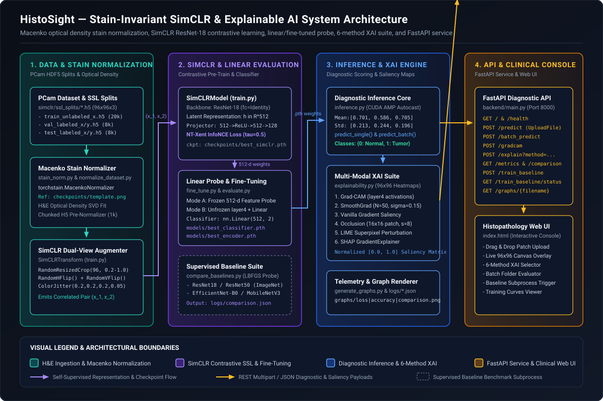

# HistoSight — System Architecture

## 1. Executive Summary

HistoSight is a computational pathology platform designed to solve two critical barriers to clinical adoption of deep learning on Hematoxylin and Eosin (H&E) whole-slide image patches:
1. **Inter-Laboratory Chromatic Variance**: Different scanners, chemical dye batches, and fixation protocols shift H&E RGB distributions, causing standard supervised CNNs to overfit to hospital-specific color artifacts.
2. **Annotation Scarcity & Black-Box Opacity**: Expert pathologist annotations are expensive to curate, and clinicians require spatially localized visual evidence before trusting an automated tumor classification.

HistoSight addresses these challenges through a four-stage pipeline: **Macenko Optical Density Stain Normalization** (`stain_norm.py`), **SimCLR Self-Supervised Contrastive Representation Learning** (`train.py`), **Linear Probing & Layer-4 Fine-Tuning** (`fine_tune.py`), and a **6-Method Explainable AI (XAI) Diagnostic Service** (`explainability.py`, `inference.py`, `backend/main.py`).

---

## 2. System Overview Diagram



### Visual Legend Key

| Tier / Symbol | Color / Style | Architectural Responsibility |
| :--- | :--- | :--- |
| **1. Data & Stain Normalization** | Teal (`#2dd4bf`) | PCam HDF5 storage (`simclr/ssl_splits/*.h5`), `MacenkoNormalizer` optical density SVD fitting (`stain_norm.py`), chunked HDF5 pre-normalization (`normalize_dataset.py`), and `SimCLRTransform` stochastic dual-view generation. |
| **2. SimCLR & Linear Evaluation** | Purple (`#a78bfa`) | `SimCLRModel` (`ResNet-18` encoder + `128-d` projection MLP) trained via `nt_xent_loss` (`train.py`), downstream `nn.Linear(512, 2)` probing/fine-tuning (`fine_tune.py`), and `LBFGS` supervised baseline benchmarking (`compare_baselines.py`). |
| **3. Inference & XAI Engine** | Blue (`#60a5fa`) | Cached CUDA AMP inference (`inference.py`), 6-method `96x96` attribution map generator (`explainability.py`), and Matplotlib telemetry renderer (`generate_graphs.py`). |
| **4. API & Clinical Console** | Amber (`#fbbf24`) | FastAPI ASGI microservice (`backend/main.py` on port `8000`) and interactive histopathology web console (`index.html`). |
| **Solid Purple Arrows** | `-->` (`#a78bfa`) | Self-supervised tensor views `(x_1, x_2)` and `512-d` encoder checkpoint weight transfer (`best_simclr.pth`). |
| **Solid Amber Arrows** | `-->` (`#fbbf24`) | Multipart image uploads, JSON diagnostic predictions, and `96x96` floating-point saliency arrays. |
| **Dashed Slate Box** | `- - -` (`#64748b`) | Non-blocking background baseline comparison subprocess (`compare_baselines.py`). |

---

## 3. Core Design Patterns & Mathematical Formulations

### 3.1 Macenko Optical Density Decomposition (`stain_norm.py`)
Raw RGB pixel intensities $I \in [0, 255]^{96 \times 96 \times 3}$ are converted to Optical Density ($OD$) space via the Beer-Lambert law:

$$OD = -\log_{10}\left(\frac{\max(I, 1)}{I_0}\right)$$

Using Singular Value Decomposition (SVD) on pixels exceeding an optical density threshold, `torchstain.normalizers.MacenkoNormalizer(backend='numpy')` estimates the 2D plane spanned by the **Hematoxylin** and **Eosin** stain vectors and normalizes every input patch to match the reference stain matrix of `checkpoints/template.png`. If SVD fails on a pure-white background patch (`test_normalize_blank_fallback`), `normalize_numpy()` catches the exception and returns the original array unchanged.

### 3.2 SimCLR Contrastive Learning & NT-Xent Loss (`train.py`)
For each normalized `96x96` patch $x$, `SimCLRTransform` samples two correlated views $(\tilde{x}_i, \tilde{x}_j)$ via random resized cropping (`scale=(0.2, 1.0)`), horizontal/vertical flips, and subtle color jitter (`p=0.4`).
- **Encoder $f(\cdot)$**: `torchvision.models.resnet18(weights=None)` with `fc = nn.Identity()`, mapping $\tilde{x} \mapsto h \in \mathbb{R}^{512}$.
- **Projection Head $g(\cdot)$**: `nn.Sequential(nn.Linear(512, 512), nn.ReLU(), nn.Linear(512, 128))`, mapping $h \mapsto z \in \mathbb{R}^{128}$.
- **NT-Xent Loss (`nt_xent_loss`)**: Given a mini-batch of $N$ patches ($2N$ augmented views), let $\text{sim}(u, v) = \frac{u^\top v}{\|u\| \|v\|}$. The loss for a positive pair $(i, j)$ with temperature $\tau = 0.5$ is:

$$\mathcal{L}_{i, j} = -\log \frac{\exp(\text{sim}(z_i, z_j) / \tau)}{\sum_{k=1}^{2N} \mathbb{1}_{[k \neq i]} \exp(\text{sim}(z_i, z_k) / \tau)}$$

Self-similarity along the diagonal is masked with $-10^4$ prior to `F.cross_entropy`.

### 3.3 Two-Mode Downstream Transfer (`fine_tune.py`)
`fine_tune.py` supports two distinct transfer learning strategies:
1. **Pre-Extracted Linear Probe (Default)**: Extracts all `512-d` feature vectors into CPU RAM once at startup (`extract_features()`), wrapping them in `FeatureDataset`. The `nn.Linear(512, 2)` classifier then trains in milliseconds per epoch without redundant CNN forward passes.
2. **Selective Block Unfreezing (`--finetune-encoder`)**: Unfreezes `encoder.layer4` while keeping earlier residual blocks (`conv1` through `layer3`) frozen and locking BatchNorm statistics (`encoder.eval()`) to prevent running-mean drift. Saves both `models/best_encoder.pth` and `models/best_classifier.pth`.

### 3.4 Atomic JSON Telemetry Persistence
All training and benchmarking scripts (`train.py`, `fine_tune.py`, `compare_baselines.py`) write JSON metrics to a temporary `.tmp` file and execute an atomic OS rename (`os.replace(tmp, path)`). This guarantees that the FastAPI server (`GET /metrics`, `GET /comparison`) never reads a half-written JSON file while training is in progress.

---

## 4. Tech Stack Justifications

| Layer | Technology | Rationale |
| :--- | :--- | :--- |
| **Deep Learning Core** | **PyTorch 2.0+ & Torchvision** | Native support for `torch.cuda.amp.autocast` (FP16 mixed precision), forward/backward autograd hooks for `Grad-CAM`, and modular `ResNet-18` / `ResNet-50` / `EfficientNet-B0` / `MobileNetV3` backbones. |
| **Stain Normalization** | **Torchstain (`>=1.3.0`)** | Provides a numerically stable NumPy/PyTorch implementation of Macenko stain vector estimation and H&E channel separation. |
| **Dataset Storage** | **HDF5 (`h5py>=3.8`)** | Enables high-speed sequential slice loading (`f['x'][:n]`) of tens of thousands of `96x96x3` uint8 histopathology patches directly into RAM (`load_h5_to_ram`) and chunked (`1,000`-patch) offline normalization. |
| **Explainable AI (XAI)** | **Custom PyTorch Hooks + `lime` + `shap`** | Combines fast white-box gradient methods (`Grad-CAM`, `SmoothGrad`, `Vanilla Saliency`) with perturbation (`Occlusion`, `LIME`) and Shapley value (`SHAP GradientExplainer`) attribution. |
| **API Microservice** | **FastAPI + Uvicorn + Python-Multipart** | Serves streaming multipart image uploads (`/predict`, `/gradcam`, `/explain`), JSON batch inference (`/batch_predict`), and static chart assets (`/graphs/{filename}`). |

---

## 5. Repository Directory Layout

```text
HistoSight/
├── backend/
│   └── main.py                       # FastAPI service (/predict, /batch_predict, /gradcam, /explain, /metrics, /comparison, /train_baseline)
├── checkpoints/
│   ├── best_simclr.pth               # Pre-trained SimCLR ResNet-18 + Projection Head checkpoint
│   └── template.png                  # Reference 96x96 H&E patch for Macenko stain normalization
├── models/
│   ├── best_classifier.pth           # Trained nn.Linear(512, 2) classification head weights
│   └── best_encoder.pth              # Fine-tuned ResNet-18 encoder weights (when --finetune-encoder is used)
├── logs/
│   ├── metrics.json                  # SimCLR pre-training epoch losses, top-1 contrastive accuracies, and epoch times
│   ├── finetune_metrics.json         # Downstream linear/fine-tuning train & val accuracy/loss history
│   └── comparison.json               # Benchmark results across SimCLR, ResNet18/50, EfficientNet-B0, & MobileNetV3
├── graphs/
│   ├── loss_curve.png                # SimCLR NT-Xent train/val loss curve
│   ├── accuracy_curve.png            # SimCLR contrastive top-1 accuracy curve
│   ├── epoch_time.png                # Pre-training wall-clock duration per epoch
│   ├── model_comparison.png          # Horizontal bar chart comparing SSL vs. ImageNet supervised baselines
│   └── system_architecture.png       # Matplotlib-rendered pipeline summary chart
├── simclr/
│   ├── pre-train.py                  # Standalone SimCLR experimental script
│   ├── fine-tune.py                  # Standalone fine-tuning experimental script
│   ├── test.py                       # Standalone evaluation script
│   └── ssl_splits/                   # HDF5 dataset splits (raw and *_normalized.h5)
├── pcamv1/                           # Original PatchCamelyon (PCam) .h5.gz archives & metadata CSVs
├── pcam_test_100_per_class/          # Curated 200-image PNG test suite (0_normal/ & 1_tumor/)
├── tests/
│   └── test_stain_norm.py            # Pytest unit tests for Macenko normalizer & blank patch fallback
├── docs/
│   ├── ARCHITECTURE.md               # Detailed system architecture guide
│   ├── API.md                        # Complete REST & Python API documentation
│   └── assets/
│       └── system-overview.svg       # Vector architecture & data flow diagram
├── stain_norm.py                     # Singleton MacenkoNormalizer manager & PIL/NumPy normalizer functions
├── normalize_dataset.py              # Offline chunked HDF5 stain normalization script
├── train.py                          # Primary SimCLR SSL pre-training pipeline
├── fine_tune.py                      # Primary linear evaluation & layer4 fine-tuning pipeline
├── evaluate.py                       # Test split accuracy & cross-entropy evaluator
├── compare_baselines.py              # Multi-model ImageNet LBFGS linear probe benchmark script
├── inference.py                      # Cached single/batch inference & Grad-CAM generator
├── explainability.py                 # 6-method XAI suite (Grad-CAM, SmoothGrad, Occlusion, LIME, SHAP, Saliency)
├── generate_graphs.py                # Dark-themed publication graph generator
├── generate_test_explanations.py     # Automated batch XAI verification runner
├── index.html                        # Interactive clinical histopathology browser console
├── paper.tex                         # LaTeX research manuscript
└── requirements.txt                  # Python dependencies
```

---

## 6. Component Breakdown

### 6.1 `stain_norm.py` & `normalize_dataset.py`
- `get_normalizer()` caches a singleton `torchstain.normalizers.MacenkoNormalizer(backend='numpy')`. If `checkpoints/template.png` does not exist, it scans the first 10 patches of `pcam_ssl_val_labeled_x.h5` and selects the first tissue-rich patch with `mean < 200` as the reference template.
- `normalize_numpy(arr)` and `normalize_image(img)` normalize any `(96, 96, 3)` uint8 array or `PIL.Image` on the fly.

### 6.2 `inference.py`
- Lazily loads and caches `_encoder` (`ResNet-18` with `fc = nn.Identity()`) and `_classifier` (`nn.Linear(512, 2)`) on `DEVICE`.
- Priority order for encoder weights: loads `models/best_encoder.pth` if present; otherwise strips the `encoder.` prefix from `checkpoints/best_simclr.pth`.
- Applies `inference_transform`: `Resize((96, 96))` -> `ToTensor()` -> `Normalize(mean=[0.7011, 0.5859, 0.7054], std=[0.2128, 0.2438, 0.1955])`.

### 6.3 `explainability.py`
Implements six distinct interpretability algorithms, each returning `(heatmap_96x96_float_0_to_1, predicted_class_str)`:
1. **`gradcam(image_path, target_layer_name="layer4")`**: Registers forward and backward hooks on `encoder.layer4`, global-average-pools the gradients over spatial dimensions `(2, 3)`, computes the weighted combination of feature maps followed by `ReLU`, and bilinearly upsamples to `96x96`.
2. **`smoothgrad(image_path, n_samples=50, noise_level=0.15)`**: Averages input-space absolute gradients $|\nabla_x \text{logit}_{c}|$ across `50` Gaussian-perturbed copies ($\sigma = 0.15$) of the normalized input tensor.
3. **`saliency(image_path)`**: Computes single-pass vanilla input gradients and takes the maximum magnitude across the 3 RGB channels.
4. **`occlusion(image_path, patch_size=16, stride=8)`**: Slides a `16x16` zero-mask across the `96x96` tensor with stride `8` (`121` evaluations) and maps the drop in predicted class softmax probability.
5. **`lime_explain(image_path, num_samples=1000)`**: Uses `lime.lime_image.LimeImageExplainer` (`top_labels=1`, `num_features=10`) to identify superpixels positively contributing to the classification.
6. **`shap_explain(image_path, n_samples=100)`**: Wraps `_encoder` and `_classifier` into `FullModel`, disables in-place `nn.ReLU` mutations (`module.inplace = False`), and computes `shap.GradientExplainer` attributions against a 10-sample zero baseline.

---

## 7. End-to-End Data Flow Patterns

### Flow A: Single-Tile Diagnostic & Explainability Request (`POST /explain`)
1. The clinician uploads a `.png` / `.tif` patch to `POST /explain?method=smoothgrad` via `index.html` or `curl`.
2. `backend/main.py` validates the file extension (`.jpg`, `.jpeg`, `.png`, `.bmp`, `.tiff`, `.tif`) and writes the stream to a secure `NamedTemporaryFile`.
3. `stain_norm.normalize_image()` normalizes the patch's H&E optical density against `checkpoints/template.png`.
4. `inference._load_models()` runs a forward pass to obtain the predicted class (`Tumor` or `Normal`) and softmax confidence (`0.0 - 1.0`).
5. `explainability.smoothgrad(tmp_path)` computes the `96x96` attribution matrix, normalizes values to `[0.0, 1.0]`, and returns the JSON payload `{"class": ..., "confidence": ..., "saliency_map": [[...]]}` before unlinking the temporary file in the `finally` block.
