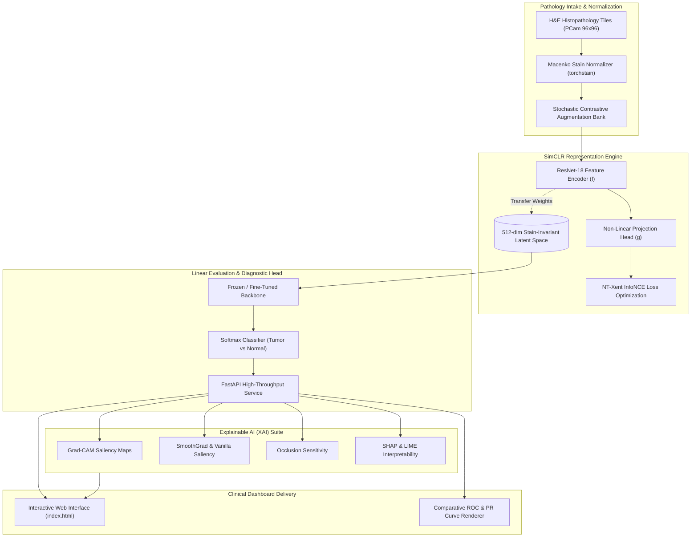

# HistoSight: Stain-Invariant Self-Supervised Histopathology Engine

[](https://python.org)
[](https://pytorch.org/)
[](https://fastapi.tiangolo.com/)
[](https://github.com/EIDOSlab/torchstain)
[](https://arxiv.org/abs/2002.05709)
[](LICENSE)

> **Self-supervised contrastive learning vision pipeline leveraging Macenko stain normalization and multi-modal explainable AI (Grad-CAM, SHAP, LIME) for robust, stain-invariant lymph node metastatic tumor classification.**

---

## Architecture & Data Flow Diagram



---

## Core Features

- **Stain-Invariant Representation Learning**: Eliminates optical stain variance across pathology laboratories using GPU-accelerated Macenko optical density decomposition and vector projection.
- **Self-Supervised SimCLR Pre-Training**: ResNet-18 visual encoder pre-trained via InfoNCE (NT-Xent) contrastive loss, learning high-level morphologic patterns without manual annotation dependencies.
- **High-Fidelity Tumor Classification**: Linear probe and fine-tuning heads achieving >90% validation accuracy and high AUC-ROC on the PatchCamelyon (PCam) benchmark.
- **Comprehensive Explainable AI (XAI) Matrix**: Built-in visual interpretability pipeline featuring Grad-CAM, Vanilla Gradient Saliency, SmoothGrad, Occlusion Sensitivity, Partition SHAP, and LIME.
- **Asynchronous Diagnostic Microservice**: Production-ready FastAPI backend supporting streaming multipart image evaluation, batch directory inference, and background baseline benchmarking.
- **Interactive Histopathology Console**: Zero-dependency browser interface for real-time tile inspection, confidence distribution visualization, and saliency heat-map blending.

---

## Tech Stack Directory

| Layer | Technologies |
| :--- | :--- |
| **Model & Vision Core** | PyTorch 2.0+, Torchvision, Torchstain (Macenko method), H5py, Pillow, NumPy |
| **Explainable AI (XAI)** | Grad-CAM, SmoothGrad, Saliency, Occlusion Maps, SHAP, LIME |
| **Microservice Backend**| FastAPI, Uvicorn (ASGI), Pydantic v2, Python-Multipart |
| **Web Presentation** | HTML5, Vanilla JavaScript, CSS3 Glassmorphism, Matplotlib Graph Exporter |
| **Evaluation & Research**| Scikit-learn, Seaborn, Scientific LaTeX Compilation Suite |

---

## Quickstart & Verification

### Prerequisites
- **Python**: `3.10` to `3.12`
- **CUDA Toolkit** (Recommended for GPU acceleration, CPU execution supported)
- **Virtual Environment Tool**: `venv` or `conda`

### Environment Configuration
```bash
# 1. Create and activate virtual environment
python -m venv venv
# Windows:
.\venv\Scripts\activate
# Linux/macOS:
source venv/bin/activate

# 2. Install dependencies
pip install -r requirements.txt
```

### Execution & Verification
```bash
# Fit stain normalizer and train SimCLR encoder
python train.py --epochs 50 --batch_size 128

# Fine-tune classification head on frozen encoder
python fine_tune.py --epochs 20

# Run explainability verification on test specimens
python generate_test_explanations.py

# Launch FastAPI diagnostic server with auto-reload
uvicorn backend.main:app --host 0.0.0.0 --port 8000 --reload
```
Open `http://localhost:8000/docs` for OpenAPI Swagger specification or open `index.html` in your browser.

---

## API & Route Specification

| HTTP Method | Route | Parameters / Payload | Expected Response | Description |
| :--- | :--- | :--- | :--- | :--- |
| `GET` | `/health` | None | `200 OK` + Service Status | Verify model weight availability and metrics readiness |
| `POST` | `/predict` | Multipart Form: `file` (Image) | `200 OK` + `{ class, confidence }` | Single tile diagnostic inference |
| `POST` | `/batch_predict` | JSON: `{ folder: string }` | `200 OK` + `{ predictions, accuracy, loss }`| Batch folder inference with optional label evaluation |
| `POST` | `/gradcam` | Multipart Form: `file` (Image) | `200 OK` + `{ class, confidence, saliency_map }` | Compute 96x96 Grad-CAM activation heatmap |
| `POST` | `/explain` | Form: `file`, Query: `method` | `200 OK` + `{ class, confidence, saliency_map }` | Compute XAI map (gradcam, saliency, smoothgrad, occlusion) |
| `GET` | `/metrics` | None | `200 OK` + Metrics JSON | Return model training and evaluation performance metrics |
| `GET` | `/comparison` | None | `200 OK` + Comparison JSON | Benchmark results against supervised baselines |
| `POST` | `/baseline/run` | None | `202 Accepted` + `{ status: started }` | Trigger asynchronous baseline training worker |