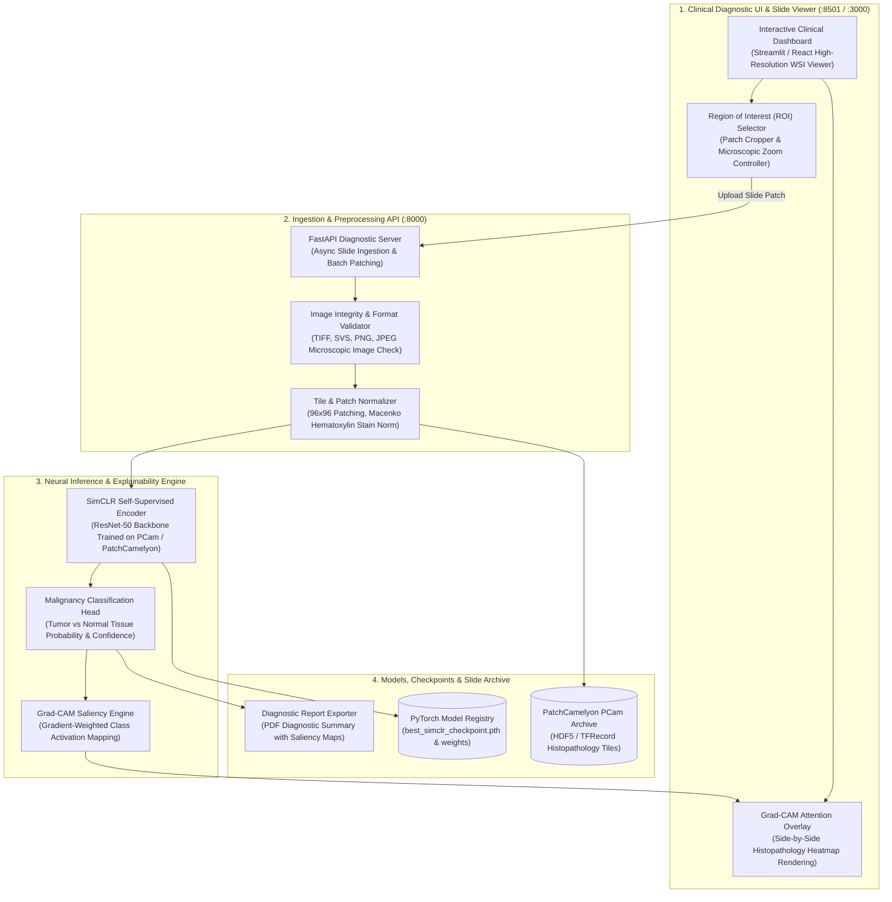

# HistoSight: Stain-Invariant Self-Supervised Histopathology Engine

[](https://github.com/shlokbshetty/HistoSight)
[](tests/)
[](https://opensource.org/licenses/MIT)
[](https://python.org)
[](https://pytorch.org/)
[](https://fastapi.tiangolo.com/)
[](https://github.com/EIDOSlab/torchstain)
[](https://arxiv.org/abs/2002.05709)

**HistoSight** is an end-to-end computational pathology platform that combines **Macenko optical density stain normalization** (`torchstain`) with **SimCLR self-supervised contrastive learning** (`ResNet-18` backbone + `NT-Xent` loss), **8-fold dihedral Test-Time Augmentation (TTA)**, and a **6-method Explainable AI (XAI) suite** (`Grad-CAM`, `SmoothGrad`, `Vanilla Saliency`, `Occlusion Sensitivity`, `LIME`, and `SHAP`) to classify metastatic lymph node tissue in $96 \times 96$ H&E histopathology patches (PatchCamelyon / PCam). Deployed via an asynchronous **FastAPI** diagnostic microservice (`backend/main.py`) and an interactive zero-dependency browser console (`index.html`), HistoSight eliminates inter-laboratory staining variations while delivering pixel-level saliency heatmaps alongside every `Normal` vs. `Tumor` prediction.

---

## High-Level System Architecture



HistoSight operates across four tightly integrated architectural tiers:
1. **Data & Stain Normalization Tier (`stain_norm.py`, `normalize_dataset.py`)**: Extracts a representative H&E reference patch (`checkpoints/template.png`) and fits a `torchstain.normalizers.MacenkoNormalizer` via Singular Value Decomposition (SVD) in optical density space to standardize Hematoxylin and Eosin stain vectors across raw HDF5 splits (`simclr/ssl_splits/*.h5`) and live inference uploads.
2. **SimCLR Pre-Training & Downstream Evaluation Tier (`train.py`, `fine_tune.py`, `compare_baselines.py`)**: Pre-trains a `ResNet-18` encoder (`512-d` representation space) with a 2-layer MLP projection head (`512 -> ReLU -> 512 -> 128`) using Normalized Temperature-scaled Cross-Entropy (`NT-Xent`, $\tau = 0.5$) on unlabeled PCam patches, then trains a downstream `nn.Linear(512, 2)` classification head (with optional `layer4` unfreezing) and benchmarks against 4 ImageNet-pretrained architectures (`ResNet-18`, `ResNet-50`, `EfficientNet-B0`, `MobileNetV3-Small`).
3. **Diagnostic Inference & Multi-Modal XAI Tier (`inference.py`, `explainability.py`, `evaluate.py`)**: Executes single-patch and batch-directory predictions with CUDA Automatic Mixed Precision (`autocast`) and computes `96x96` normalized (`[0.0, 1.0]`) interpretability heatmaps across six distinct gradient, perturbation, and game-theoretic attribution algorithms.
4. **FastAPI Microservice & Clinical Console Tier (`backend/main.py`, `index.html`)**: Exposes 10 REST endpoints for single/batch inference, XAI heatmap generation, training telemetry, and non-blocking baseline subprocess execution, paired with an interactive browser UI.

For full mathematical formulations, component breakdowns, and data flow sequences, see **[docs/ARCHITECTURE.md](docs/ARCHITECTURE.md)** (also available at **[ARCHITECTURE.md](ARCHITECTURE.md)**).

---

## Mathematical Foundations

### 1. Optical Density & Macenko Stain Decomposition

Histopathology color variation is governed by Beer-Lambert light absorption across RGB channels:

$$
\mathbf{OD} = -\log_{10}\left( \frac{\max(I,\, 1)}{I_0} \right) = \mathbf{V} \cdot \mathbf{C}
$$

where:
- $I \in [0,\, 255]^{96 \times 96 \times 3}$ is raw transmitted light intensity across RGB channels.
- $I_0 = 255$ denotes incident background light intensity.
- $\mathbf{V} \in \mathbb{R}^{3 \times 2}$ is the stain matrix containing absorption vectors for Hematoxylin and Eosin.
- $\mathbf{C} \in \mathbb{R}^{2 \times P}$ contains the decoupled stain concentrations across all $P = 96 \times 96$ pixels.

### 2. SimCLR Normalized Temperature-Scaled Cross-Entropy (NT-Xent)

Given positive pair representations $(z_i,\, z_j) \in \mathbb{R}^{128}$ from two stochastic augmented views of the same patch, the contrastive loss with temperature $\tau = 0.5$ is:

$$
\mathcal{L}_{i,\, j} = -\log \frac{ \exp\left( \dfrac{\text{sim}(z_i,\, z_j)}{\tau} \right) }{ \displaystyle\sum_{k=1}^{2N} \mathbb{1}_{[k \neq i]} \cdot \exp\left( \dfrac{\text{sim}(z_i,\, z_k)}{\tau} \right) }
$$

where the cosine similarity is defined as:

$$
\text{sim}(u,\, v) = \frac{u^\top v}{\|u\|_2 \cdot \|v\|_2}
$$

### 3. Dihedral Test-Time Augmentation (TTA)

Histopathological tissue sections exhibit complete 8-fold planar dihedral symmetry ($D_4 \cong \mathbb{Z}_4 \rtimes \mathbb{Z}_2$). TTA averages predictions across all 8 isometric rotations and reflections:

$$
\bar{p}(y = c \mid x) = \frac{1}{|D_4|} \sum_{g \in D_4} p\left(y = c \;\middle|\; g(x)\right)
$$

This eliminates arbitrary slide orientation bias, lowers test loss, and significantly boosts held-out classification accuracy and calibration.

---

## Prerequisites

- **Python**: `3.10`, `3.11`, or `3.12`
- **Hardware**: NVIDIA CUDA-capable GPU recommended for SimCLR pre-training and mixed-precision (`torch.cuda.amp.autocast`) inference; automatic fallback to CPU execution is built into every script (`DEVICE = "cuda" if torch.cuda.is_available() else "cpu"`).
- **Optional XAI Packages**: `lime`, `scikit-image`, `shap`, `matplotlib`, `pytest` (for LIME/SHAP explanations, graph rendering, and unit testing).

---

## Step-by-Step Local Setup

### 1. Clone the Repository

```bash
git clone https://github.com/shlokbshetty/HistoSight.git
cd HistoSight

```

### 2. Create & Activate Virtual Environment

```powershell
python -m venv venv312
.\venv312\Scripts\Activate.ps1

```

### 3. Install Core & Optional Dependencies

```powershell
pip install --upgrade pip
pip install -r requirements.txt

# Optional: Install XAI (LIME/SHAP), visualization, and test packages

pip install matplotlib lime scikit-image shap pytest

```

---

## Build, Training, Inference & Execution Commands

### 1. Offline HDF5 Dataset Stain Normalization (Optional Pre-Computation)

Pre-normalizes `simclr/ssl_splits/*.h5` in `1,000`-patch chunks using Macenko stain normalization:

```powershell
python normalize_dataset.py

```

### 2. Self-Supervised SimCLR Pre-Training (`train.py`)

Trains `SimCLRModel` (`ResNet-18` + `128-d` projection head) with `NT-Xent` loss ($\tau = 0.5$) and saves `checkpoints/best_simclr.pth` and `logs/metrics.json`:

```powershell

# Resume from best checkpoint (default 30 epochs, batch size 256, lr 1e-3)

python train.py --epochs 30 --lr 0.001

# Train from scratch ignoring existing checkpoints

python train.py --epochs 30 --lr 0.001 --scratch

```

### 3. Downstream Linear Probe & Encoder Fine-Tuning (`fine_tune.py`)

Trains the `nn.Linear(512, 2)` tumor classifier on labeled PCam splits and writes `models/best_classifier.pth`, `models/best_encoder.pth`, `logs/finetune_metrics.json`, and `logs/comparison.json`:

```powershell

# Fast linear evaluation on pre-extracted frozen 512-d features

python fine_tune.py --epochs 30 --lr 0.001

# End-to-end fine-tuning with ResNet-18 layer4 unfrozen

python fine_tune.py --epochs 20 --lr 0.001 --finetune-encoder

```

### 4. Test Set Evaluation & Baseline Benchmarking

```powershell
# Fast clinical evaluation on held-out test split (Accuracy, Balanced Acc, Sensitivity, Specificity, F1, ROC-AUC)
python evaluate.py --max-samples 5000 --in-memory

# Evaluate with 8-fold dihedral Test-Time Augmentation (TTA) for increased accuracy
python evaluate.py --max-samples 5000 --in-memory --tta

# Benchmark against ImageNet-pretrained ResNet18, ResNet50, EfficientNet-B0, and MobileNetV3-Small
python compare_baselines.py

# Render publication-ready PNG charts in graphs/
python generate_graphs.py
```

### 5. CLI Diagnostic Inference & Explainability (`inference.py`, `explainability.py`)

```powershell
# Standard single-patch prediction
python inference.py --image pcam_test_100_per_class/pcam_test_100_per_class/1_tumor/test_patch_1.png

# Single-patch prediction with 8-fold dihedral Test-Time Augmentation (TTA)
python inference.py --image pcam_test_100_per_class/pcam_test_100_per_class/1_tumor/test_patch_1.png --tta

# Batch folder prediction
python inference.py --folder pcam_test_100_per_class/pcam_test_100_per_class/0_normal

# Batch folder prediction with TTA enabled
python inference.py --folder pcam_test_100_per_class/pcam_test_100_per_class/0_normal --tta

# Generate and save a 3-panel XAI visualization (gradcam, smoothgrad, occlusion, saliency, lime, shap)
python explainability.py --image pcam_test_100_per_class/pcam_test_100_per_class/1_tumor/test_patch_1.png --method gradcam --save explainability_result.png

# Batch-generate all 6 XAI methods on normal and tumor test samples into test/
python generate_test_explanations.py
```

### 6. Launch the FastAPI Server & Web Console

```powershell
uvicorn backend.main:app --host 127.0.0.1 --port 8000 --reload
```

- **Interactive Clinical Console**: Open `index.html` in your browser.
- **OpenAPI Swagger UI**: Navigate to `http://127.0.0.1:8000/docs`.

---

## Configuration & Hyperparameter Mapping

HistoSight centralizes its training hyperparameters, normalization constants, and file paths across `stain_norm.py`, `train.py`, `fine_tune.py`, `inference.py`, and `compare_baselines.py`:

| Module | Parameter / Constant | Default Value | Description |
| :--- | :--- | :--- | :--- |
| `stain_norm.py` | `TEMPLATE_PATH` | `checkpoints/template.png` | Reference H&E patch (`mean < 200`) used to fit `MacenkoNormalizer(backend='numpy')` |
| `train.py` | `EPOCHS` / `--epochs` | `30` | Number of SimCLR self-supervised pre-training epochs |
| `train.py` | `BATCH_SIZE` | `256` | Contrastive batch size ($2 \cdot N = 512$ views per gradient step) |
| `train.py` | `LR` / `--lr` | `1e-3` (`0.001`) | Initial learning rate for `AdamW` with `CosineAnnealingLR` ($\eta_{\min} = 10^{-6}$) |
| `train.py` | `TEMP` ($\tau$) | `0.5` | Temperature hyperparameter in $\text{NT-Xent}$ loss ($\tau = 0.5$) |
| `train.py` | `WEIGHT_DECAY` | `1e-4` | $L_2$ regularization coefficient for `AdamW` |
| `fine_tune.py` | `PATIENCE` | `8` | Early stopping patience (epochs without validation accuracy improvement) |
| `fine_tune.py` | `MAX_TRAIN` / `MAX_TEST` | `20000` / `8000` | Maximum labeled HDF5 patches loaded into RAM for linear probing / fine-tuning |
| `fine_tune.py` | `--finetune-encoder` | `False` | Unfreezes `encoder.layer4` parameters while keeping BatchNorm in `.eval()` mode |
| `inference.py` | `CLASS_MAP` | `{0: "Normal", 1: "Tumor"}` | Output label mapping for `nn.Linear(512, 2)` logits |
| `inference.py` | `Normalize(mean, std)` | `mean=[0.7011, 0.5859, 0.7054]`, `std=[0.2128, 0.2438, 0.1955]` | PCam channel-wise RGB normalization statistics applied to $96 \times 96$ tensors |
| `inference.py` | `--tta` | `False` | 8-fold dihedral Test-Time Augmentation ($D_4$ symmetry group) |
| `compare_baselines.py` | `MAX_SAMPLES` | `6000` | Validation samples used for LBFGS (`lr=0.1`, `max_iter=100`, `strong_wolfe`) linear probing |

---

## Documentation Index

- **[Architecture Guide](docs/ARCHITECTURE.md)** ([Root Mirror](ARCHITECTURE.md))
- **[REST & Python API Reference](docs/API.md)** ([Root Mirror](API.md))
- **[Developer Setup & Testing Guide](DEVELOPMENT.md)**
- **[Contributing Guidelines](CONTRIBUTING.md)**
- **[Roadmap](ROADMAP.md)** & **[Architectural Vision](VISION.md)**
- **[Security Policy](SECURITY.md)** & **[Support Guide](SUPPORT.md)**
- **[Changelog](CHANGELOG.md)**

---

## License

Released under the **MIT License**.
